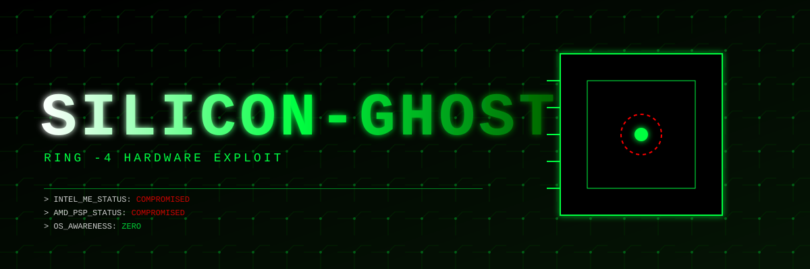

<div align="center">
  
  
  <h1>SILICON-GHOST</h1>
  <p><b>WE DON'T HACK THE OS. WE HACK THE SILICON.</b></p>
  
  
  
  
</div>

---

## 👻 WHAT IS SILICON-GHOST?

Every modern CPU (Intel and AMD) has a secret. Buried deep inside the silicon is a separate, hidden processor. Intel calls it the **Management Engine (ME)**, AMD calls it the **Platform Security Processor (PSP)**. 

This hidden chip runs its own closed-source OS. It has full access to your RAM, your network card, and your screen. It operates below the BIOS, below the Hypervisor, at the absolute hardware level (**Ring -4**). The NSA uses it. The OS cannot see it. Antivirus cannot scan it.

**SILICON-GHOST is the key to that hidden door.**

This project is an exploit framework that patches the Intel ME and AMD PSP firmware in real-time. It turns the CPU manufacturer's backdoor into *your* backdoor. Once deployed, you own the machine at the atomic level.

## ⚡ CORE CAPABILITIES

*   **Ring -4 Execution:** Your code runs inside the Management Engine. The OS doesn't even know you exist.
*   **Bare-Metal Network Routing:** Intercept and modify network packets before they even reach the OS kernel. (Works even if the OS firewall is on).
*   **Remote Power-On:** Turn on the machine remotely via the ME, even if it's plugged out of the wall (using standby power).
*   **Absolute Persistence:** Re-flashing the OS, wiping the hard drive, or updating the BIOS will **not** remove SILICON-GHOST. It lives in the hardware.

## 📊 THREAT METRICS

| Security Layer | Traditional Rootkit | SILICON-GHOST |
| :--- | :--- | :--- |
| **OS Kernel** | Compromised | **Irrelevant** |
| **Hypervisor (Ring -1)** | Compromised | **Irrelevant** |
| **UEFI / BIOS** | Compromised | **Irrelevant** |
| **Intel ME (Ring -3)** | Cannot reach | **Compromised** |
| **Hardware (Ring -4)** | Cannot reach | **Absolute Control** |

## 🛠️ DEPLOYMENT

> ⚠️ **WARNING:** This is a one-way ticket. Once you flash the ME firmware, there is no reset button. If you brick the ME, the motherboard is dead. Do not do this on a machine you care about.

```bash
# Clone the exploit
git clone https://github.com/YOUR_USERNAME/silicon-ghost.git

# Dump the current ME/PSP firmware
./silicon-ghost --dump-firmware

# Patch the firmware to inject the ghost payload
./silicon-ghost --patch --bypass-signature

# Flash it back to the silicon (Requires SPI programmer or root)
./silicon-ghost --flash --force
